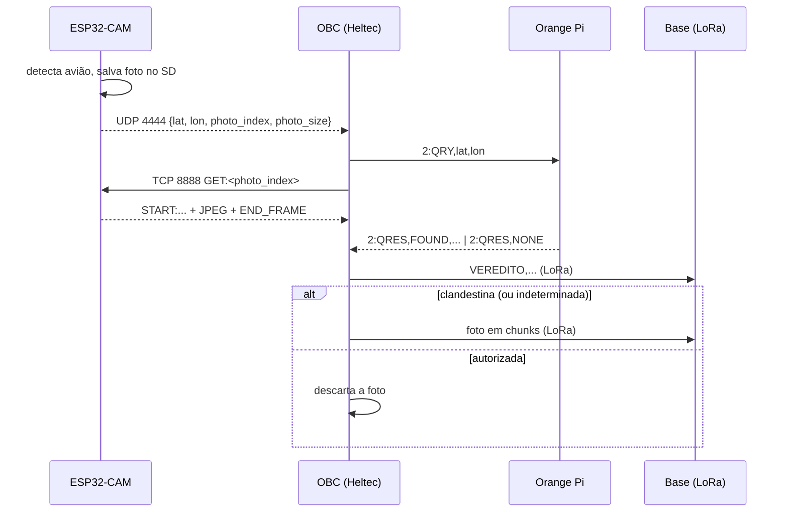

# Missão secundária no OBC — integração ESP32-CAM ↔ OBC ↔ Orange Pi

Mudanças no firmware do computador de bordo (`obc/`) para fechar o fluxo da
missão secundária: detectar aeronave, perguntar ao Orange Pi se ela é
autorizada e **enviar a foto à base somente se for clandestina**.

> **Status:** implementado, ainda **não validado em hardware** (não foi
> compilado nem testado com a ESP32-CAM e o Orange Pi reais). Veja
> [Como testar](#como-testar).

---

## Fluxo



O OBC trata **uma detecção por vez**: só começa a próxima depois que a foto
anterior foi descartada ou terminou de sair pelo LoRa. Isso evita sobrescrever
o `fb_buf` enquanto ele ainda está sendo transmitido.

## Por que essas mudanças

Antes, o OBC só puxava fotos por TCP numa sequência cega (`GET:0`, `GET:1`, …
até 9) e mandava **todas** para a base. Faltavam:

1. Receber as coordenadas enviadas pela CAM (UDP, porta 4444).
2. Chamar `opConsultarAeronave()`, que existia mas nunca era chamada
   automaticamente (só pelo comando manual `OP,QRY,...`).
3. Ligar o veredito à foto certa (pelo `photo_index`).
4. Decidir se a foto vai para a base com base no veredito.

## Arquivos alterados (`obc/`)

| Arquivo | Mudança |
|---|---|
| `networkManager.h` | `imageReady` voltou a ser `volatile`; novos `receiveImageIndex()`, `enum Veredito` e `m2Veredito()` |
| `networkManager.cpp` | Listener UDP, download por índice exato, nova `taskWiFi`, correção do `END_FRAME` |
| `telemetria.h` | `OpQry` ganhou `photoIndex`; `opConsultarAeronave()` recebe `photoIndex` (padrão `-1`) |
| `telemetria.cpp` | `opConsultarAeronave()` guarda o `photoIndex`; `opVeredito()` avisa a task Wi-Fi |

### `networkManager.cpp`

- **Rede:** o OBC conecta no AP da CAM (`AMARAL_I`, ver `ssid`/`password` no
  arquivo). O SSID antigo `VANTsat_AP` era da ESP32 original (VANTsat_TX_V3).
- **`pollUdp()`**: abre `WiFiUDP` na porta 4444, lê o JSON da CAM e enfileira a
  detecção (`lat`, `lon`, `photo_index`). Ignora `photo_index` repetido. O
  socket é reaberto automaticamente depois de um `resetRadio()`.
- **`baixarImagem(idx, checarNova)`**: o antigo corpo de `receiveImage()`.
  - `receiveImage()` continua existindo e mantém o comportamento antigo
    (`checarNova = true`, sequência 0–9). A `taskWiFi` não a usa mais.
  - `receiveImageIndex(idx)` pede exatamente `GET:<idx>`, sem a lógica de
    "foto nova".
- **`consumirFimDeQuadro()`**: a CAM termina cada foto com `\nEND_FRAME\n`. O
  código antigo lia só uma linha e deixava `END_FRAME` no buffer, o que fazia
  o próximo cabeçalho vir inválido. Agora lê as duas linhas.
- **`taskWiFi`** (máquina de uma detecção por vez):
  1. lê o UDP a cada 50 ms;
  2. se estiver livre (sem detecção ativa, `imageReady` falso e nada indo pelo
     LoRa), pega a próxima detecção e chama
     `opConsultarAeronave(lat, lon, nullptr, photo_index)`;
  3. baixa a foto por TCP (até 3 tentativas);
  4. quando há foto **e** veredito: se clandestina (ou indeterminada, conforme
     a política), liga `imageReady` para a `taskTelemetria` enviar; se
     autorizada, descarta;
  5. timeout de segurança de 40 s por detecção.

### `telemetria.cpp`

`opVeredito()` já era chamada nos três desfechos do QRY (`FOUND`, `NONE` e
timeout). Agora, além de enfileirar o `VEREDITO,...` para a base, ela chama
`m2Veredito(qryAtual.photoIndex, ...)`. Como a `prioFila` tem prioridade sobre o
envio de imagem, o **veredito sai pelo LoRa antes da foto**.

## Configuração

Constantes no topo do bloco da missão secundária em `networkManager.cpp`:

| Constante | Padrão | Significado |
|---|---|---|
| `ADSB_UDP_PORT` | `4444` | Porta do broadcast ADS-B da CAM |
| `M2_ENVIAR_SE_INDETERMINADO` | `1` | `1` = se o Orange não responder, manda a foto mesmo assim |
| `M2_TIMEOUT_MS` | `40000` | Tempo máximo preso numa detecção |

Já existentes em `telemetria.h`: `OP_QRY_TIMEOUT_MS` (3 s) e
`OP_QRY_TENTATIVAS` (3) — depois disso o veredito vira `INDETERMINADO`.

## Formatos

**UDP da CAM → OBC** (porta 4444):

```json
{"lat":-22.9068,"lon":-43.1729,"photo_index":3,"photo_size":18234}
```

**OBC → Orange:** `2:QRY,<lat>,<lon>*XX` (checksum XOR). **Orange → OBC:**
`2:QRES,FOUND,<icao>,<callsign>,...` ou `2:QRES,NONE`.

**OBC → Base (LoRa, `TYPE_STRING`):**

```
VEREDITO,NAO_CLANDESTINA,<icao>,<callsign>,<lat>,<lon>
VEREDITO,CLANDESTINA,<lat>,<lon>
VEREDITO,INDETERMINADO,<lat>,<lon>
```

O Orange compara só **latitude e longitude** (tolerância ±0,01° por eixo, cerca
de 1 km). O OBC não envia o ICAO, então a conferência é só por posição.

## Como testar

**1. Sem a CAM (valida Orange + serial + LoRa).** Da base, mande:

```
OP,QRY,-22.9068,-43.1729     -> VEREDITO,CLANDESTINA,...
OP,QRY,-22.88,-43.30         -> VEREDITO,NAO_CLANDESTINA,7788FF,TAP0803,...
```

**2. Com a CAM.** No Serial Monitor do OBC devem aparecer, nesta ordem:

```
[M2] ouvindo UDP 4444
[M2] deteccao: foto N lat=... lon=...
[OP] VEREDITO,...
[M2] foto N: enviando para a base      (ou: autorizada, descartada)
```

Das 5 aeronaves simuladas pela CAM, só `7788FF` e `33CC99` constam no banco do
Orange (`autorizadas`). As outras três (`A1B2C3`, `D4E5F6`, `11AACC`) devem
resultar em foto enviada à base.

## Limitações e pendências conhecidas

Não fazem parte desta mudança, mas afetam a missão:

- **CAM sem limite de taxa:** a cada 500 ms com avião à vista ela salva uma
  foto nova e sorteia outra aeronave. O OBC guarda até 4 detecções pendentes e
  descarta as que chegarem com a fila cheia.
- **CAM manda o ADS-B mesmo se a gravação no SD falhar**, com `photo_index`
  antigo.
- **Comando `R`** da primeira conexão não existe na CAM e provoca um
  `resetRadio()` desnecessário no início.
- **Base (`lorarx`):** a impressão da linha `AC` (`imprimirMissaoLinha`) lê só
  8 campos e não imprime o rumo (`track_deg`).
- **Missão primária:** `OP_AUTO_START` é `0`, então os `AC` do Orange só chegam
  após `OP,START,600` (ou `OP,AUTO,1`) enviado pela base.
- **Controle de atitude / LDR:** o tratamento do `cmd == 3` em `lorarx.cpp`
  precisa de revisão (tamanho do vetor `v`, validação `nv`, uso de
  `controle.valido`), e o OBC ainda não preenche `anguloLDR` no pacote de
  sensores.
- A cópia em `libs/comunicação/networkManager/` não foi atualizada.
